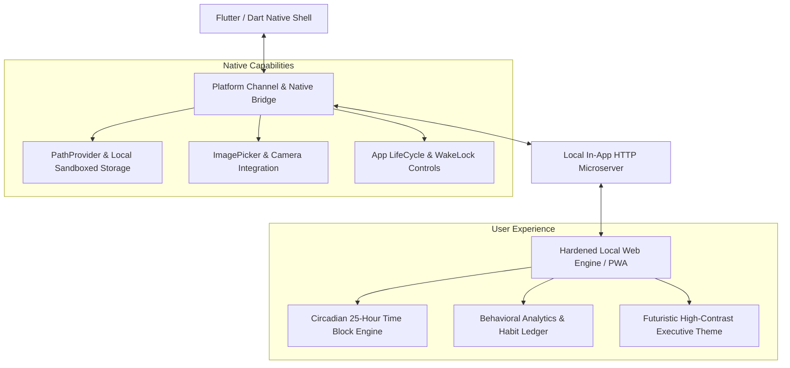

# Apex Leader OS — Cross-Platform Behavioral Intelligence & Executive Engine

[](https://flutter.dev)
[](https://dart.dev)
[](#architecture)
[](#cross-platform-support)
[](LICENSE)

**Apex Leader OS** is an executive-grade behavioral intelligence and high-performance productivity application engineered with **Flutter**, **Dart**, and an **embedded offline-first HTTP bridge**. Built to maintain focus, track circadian deep-work blocks, and deliver zero-latency state synchronization without external cloud dependencies.

---

## 🏛 Architecture



---

## 🌟 Key Engineering Highlights

### 1. Hybrid Offline-First Architecture
- Pairs Flutter's native platform performance with an embedded local micro-server (`HttpServer.bind(InternetAddress.loopbackIPv4)`).
- Provides instant app launch with zero network latency and complete privacy guarantees.

### 2. High-Performance Platform Bridge
- Seamless communication between Dart native platform channels and sandboxed local UI components.
- Handles native file system persistence, local image asset caching, and system UI overlay theming.

### 3. Cross-Platform Support
- Engineered for seamless execution across **Android**, **iOS**, **Web**, and **Windows**.

---

## 📂 Repository Structure

```
apex_leader_os/
├── lib/
│   └── main.dart              # Native Flutter shell, local microserver, and WebView controller
├── assets/                    # Bundled offline application assets and media
├── android/                   # Android native platform implementation
├── ios/                       # iOS native platform implementation
├── web/                       # Web platform entrypoint
├── windows/                   # Windows desktop platform implementation
├── pubspec.yaml               # Flutter dependencies & assets manifest
└── README.md                  # Project overview & architectural guide
```

---

## ⚡ Quick Start

### Prerequisites
- [Flutter SDK](https://flutter.dev/docs/get-started/install) 3.19+
- Android Studio / Xcode / VS Code

### Run Locally

```bash
# Clone the repository
git clone https://github.com/mansurrradjabov008-afk/apex-leader-os.git
cd apex-leader-os

# Get dependencies
flutter pub get

# Run on connected device or emulator
flutter run
```

---

## 👤 Author

**Mansurjon Radjabov**
- LinkedIn: [linkedin.com/in/mansurjon-radjabov](https://linkedin.com/in/mansurjon-radjabov)
- Telegram: [@radjabovmansur](https://t.me/radjabovmansur)
- GitHub: [@mansurrradjabov008-afk](https://github.com/mansurrradjabov008-afk)
